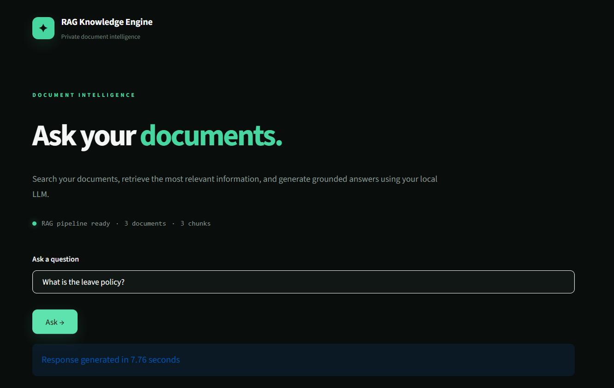
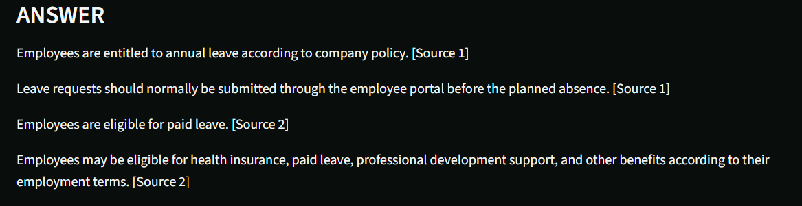
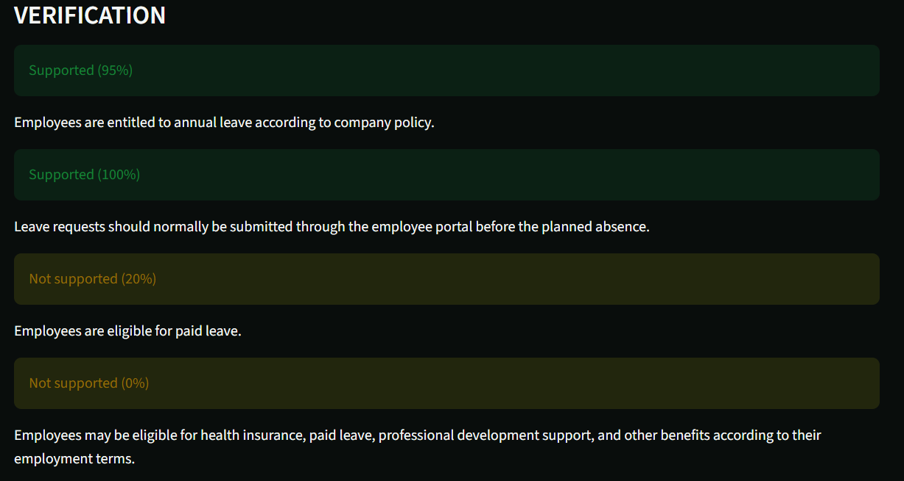

# Hybrid Search RAG with Citation Verification

A document-based question-answering system built using **Retrieval-Augmented Generation (RAG)**. It combines semantic and keyword search, cross-encoder reranking, local LLM-based answer generation, and sentence-level citation verification to identify unsupported claims.

## Features

- **PDF Document Processing:** Extracts text from PDF documents and splits it into searchable chunks.
- **Hybrid Search:** Combines FAISS semantic search and BM25 keyword search.
- **Reciprocal Rank Fusion (RRF):** Merges search results from both retrieval methods.
- **Cross-Encoder Reranking:** Reranks retrieved documents based on relevance.
- **Local LLM:** Uses Ollama with Llama 3.2 to generate answers from retrieved sources.
- **Citation Verification:** Checks whether cited document content supports individual claims.
- **Unsupported Claim Detection:** Flags missing or unsupported citations.
- **Streamlit Interface:** Displays generated answers, source documents, verification results, and response times.


## Application Screenshots

### 1. RAG Application Interface
The Streamlit dashboard allows users to ask questions about their documents.



### 2. Generated Answer with Citations
The system generates answers using retrieved document content and includes source citations.




### 3. Citation Verification

Each claim is checked against its cited source and marked as Supported or Not Supported.



### 4. Retrieved Document Sources

The application displays the PDF documents and page numbers used during answer generation.


## Tech Stack

**Language:** Python

**Framework:** Streamlit

**Vector Search:** FAISS

**Keyword Search:** BM25

**Reranking:** Sentence Transformers Cross-Encoder

**LLM:** Ollama (Llama 3.2)

**PDF Processing:** PyPDF

## System Architecture

```text
PDF Documents
      |
      v
Document Loading & Chunking
      |
      v
FAISS Search + BM25 Search
      |
      v
Reciprocal Rank Fusion (RRF)
      |
      v
Cross-Encoder Reranking
      |
      v
Ollama (Llama 3.2)
      |
      v
Answer + Source Citations
      |
      v
Sentence-Level Citation Parsing
      |
      v
LLM-Based Citation Verification
      |
      v
Streamlit User Interface
```

## Installation

**1. Clone the repository**

```bash

git clone https://github.com/bytebelle-ai/hybrid-rag-citation-verification.git
cd hybrid-rag-citation-verification

```

**2. Create a virtual environment**

```bash
python -m venv venv
```

**3. Activate the environment**

Windows PowerShell:

```powershell
.\venv\Scripts\Activate.ps1
```

**4. Install dependencies**

```bash
pip install -r requirements.txt
```

**5. Install and set up Ollama**

Install Ollama from https://ollama.com and download the model:

```bash
ollama pull llama3.2
```

Make sure Ollama is running locally.

**6. Add PDF documents**

Place your PDF documents inside:

```text
data/raw_docs/
```

**7. Run the application**

```bash
python -m streamlit run app/app.py
```

## Example Usage

**Question:** What is the leave policy?

The system retrieves relevant PDF content, generates an answer with source citations, and checks whether each cited claim is supported.

Verification results may include:

- **Supported:** The cited source supports the claim.
- **Not Supported:** The verifier did not find sufficient support in the cited source.
- **Unverified:** The claim has no valid source citation.

Verification uses an LLM and may make mistakes. Confidence scores are model-generated assessments, not calibrated probabilities.

## Limitations

- Requires Ollama and the Llama 3.2 model to run locally.
- Citation generation is not guaranteed for every answer.
- LLM-based verification can produce incorrect judgments.
- Sentence splitting may require improvements for complex punctuation.
- Performance depends on local hardware and document size.

## Future Improvements

- More robust citation alignment and validation.
- Automated evaluation on a larger document collection.
- Faster answer generation and verification.
- Support for additional document formats.

## Project Purpose

This project demonstrates an end-to-end RAG pipeline with hybrid retrieval, relevance reranking, grounded answer generation, and claim-level citation verification.